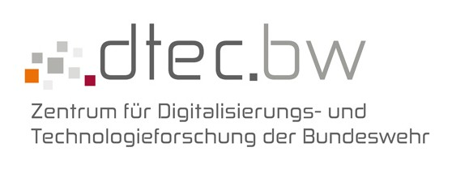

<!--
SPDX-License-Identifier: AGPL-3.0-or-later
Copyright (C) 2022-2023 Dyne.org foundation <foundation@dyne.org>.

This program is free software: you can redistribute it and/or modify
it under the terms of the GNU Affero General Public License as
published by the Free Software Foundation, either version 3 of the
License, or (at your option) any later version.

This program is distributed in the hope that it will be useful,
but WITHOUT ANY WARRANTY; without even the implied warranty of
MERCHANTABILITY or FITNESS FOR A PARTICULAR PURPOSE.  See the
GNU Affero General Public License for more details.

You should have received a copy of the GNU Affero General Public License
along with this program.  If not, see <https://www.gnu.org/licenses/>.
-->

<p align="center">
  <h1>ZENFLOWS BANK</h1>

CLI to manage distribution of _idea_, _strengths_ and _fabcoin_ tokens,
compatible with [zenflows-wallet](https://github.com/interfacerproject/zenflows-wallet)
database and the ethereum network (tested on Polygon).

</p>

<div align="center">

# Zenflows BANK

### Ease token management for _interfacer_ economic model

</div>

<p align="center">
  <a href="https://dyne.org">
    
  </a>
</p>

### What is **INTERFACER?**

The goal of the INTERFACER project is to build the open-source digital infrastructure for Fab Cities.

Our vision is to promote a green, resilient, and digitally-based mode of production and consumption that enables the greatest possible sovereignty, empowerment and participation of citizens all over the world.
We want to help Fab Cities to produce everything they consume by 2054 on the basis of collaboratively developed and globally shared data in the commons.

To know more [DOWNLOAD THE WHITEPAPER](https://www.interfacerproject.eu/assets/news/whitepaper/IF-WhitePaper_DigitalInfrastructureForFabCities.pdf)

## Zenflows BANK Features
- private keys don't have to be stored on the server (thanks to SSH Tunnel)
- clear export in multiple formats (CSV and XLSX)

### 🚩 Table of Contents

-   [💾 Install](#-install)
-   [🎮 Quick start](#-quick-start)
-   [😍 Acknowledgements](#-acknowledgements)
-   [🌐 Links](#-links)
-   [👤 Contributing](#-contributing)
-   [💼 License](#-license)


---

## 💾 Install

Bulding with Go from the source requires Go version 1.19 or later.
If you have the Go toolchain and a POSIX-compliant make(1)
implementation installed (GNU make(1) works), you can just run:

	make

which builds a the service as the executable named `bank`.

**[🔝 back to top](#toc)**

---

## 🎮 Quick start
Set up the `app.env` file with the required environment variables, one can see and example in `app.env.example`.

```
## installed instance of the zenflows backend
ZENFLOWS_URL="https://zenflows-test.interfacer.dyne.org/api"

# a user and SK for the bank on the zenflows backend
ZENFLOWS_USER=...
ZENFLOWS_SK=...

## tarantool database where points are stored
TT_HOST="localhost:3500"
TT_USER=...
TT_PASS=...
# this may require an ssh tunnel in production

# ERC20 address of our coin
FABCOIN=...

# explorer of the blockchain for the tx broadcast
ETHEREUM_URL="https://rpc-mumbai.maticvigil.com"
# secret key of the bank, owner of the coin genesis
ETHEREUM_SK=...
```

Once the env vars are set, one can export a summary of the _idea_ and _strengths_ in excel format using
```
bank list --output list.xlsx
```

Then, one can distribute fabcoins using
```
bank airdrop --input list.csv --output txid.xlsx
```

Which will return a list of transaction ids executed on the blockchain and verifiable using an explorer.

Airdrop also takes parameters: quantity to airdrop and minimum thresholds of strength and idea points to be eligible
```
Usage:
  bank airdrop [flags]

Flags:
      --fabcoinsAmount int   fabcoinsAmount to transfer (default 100)
  -h, --help                 help for airdrop
      --minIdea int          minimum amount of idea. Defaults to 10 (default 10)
      --minStrengths int     minimum amount of strengths. Defaults to 10 (default 10)
```

the default rule is "if one has more than 10 _idea_ points and more than 10 _strengths_ points, then he receives 100 _fabcoins_". The specific amount can be changed. The minimum threshold is `idea AND strength`, setting one to zero will ignore the value.

**[🔝 back to top](#toc)**

---
## 😍 Acknowledgements

### Funding

#### October 2021 – March 2023

This project was funded by the European Regional Development Fund (ERDF) as part of the INTERFACER project.


#### January 2025 – December 2026

The further development of this project was supported as part of the "Fab City – Decentralized Digital Production for Urban Value Creation" project, funded by dtec.bw and supported by the European Union – NextGenerationEU.

<p>
  
  
</p>


<a href="https://dyne.org">
  
</a>

Copyleft (ɔ) 2023 by [Dyne.org](https://www.dyne.org) foundation, Amsterdam

Designed, written and maintained by Alberto Lerda and Denis Roio

**[🔝 back to top](#toc)**

---

## 🌐 Links

https://www.interfacer.eu/

https://dyne.org/

**[🔝 back to top](#toc)**

---

## 👤 Contributing

1.  🔀 [FORK IT](../../fork)
2.  Create your feature branch `git checkout -b feature/branch`
3.  Commit your changes `git commit -am 'Add some fooBar'`
4.  Push to the branch `git push origin feature/branch`
5.  Create a new Pull Request
6.  🙏 Thank you

**[🔝 back to top](#toc)**

---

## 💼 License

    Zenflows INBOX - Federated simple **inbox** for interfacer-gui
    Copyleft (ɔ) 2023 Dyne.org foundation

    This program is free software: you can redistribute it and/or modify
    it under the terms of the GNU Affero General Public License as
    published by the Free Software Foundation, either version 3 of the
    License, or (at your option) any later version.

    This program is distributed in the hope that it will be useful,
    but WITHOUT ANY WARRANTY; without even the implied warranty of
    MERCHANTABILITY or FITNESS FOR A PARTICULAR PURPOSE.  See the
    GNU Affero General Public License for more details.

    You should have received a copy of the GNU Affero General Public License
    along with this program.  If not, see <http://www.gnu.org/licenses/>.

**[🔝 back to top](#toc)**
